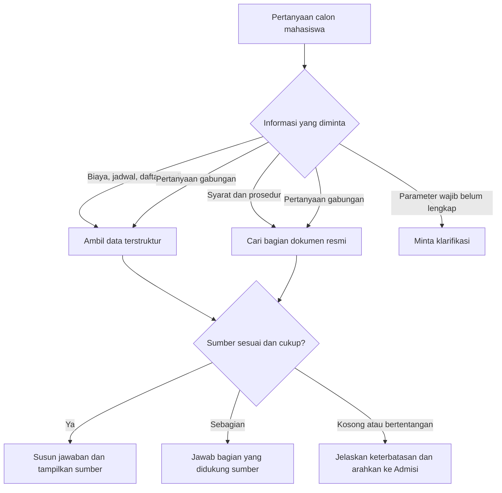

# Rancangan Chatbot Admisi UNJANI

**Usulan versi pertama (MVP)** · Chat publik berbahasa Indonesia untuk calon mahasiswa dan orang tua. Tim Admisi mengesahkan isi dan masa berlaku sumber. Sisfo mengelola aplikasi, akses admin, dan pemantauan.

## 1. Cakupan dan hasil yang diharapkan

Calon mahasiswa dapat bertanya tentang program studi, jalur seleksi, syarat, cara mendaftar, jadwal, dan biaya. Chatbot menjawab dengan singkat dan menyertakan tautan resmi. Untuk dokumen, tampilkan judul dan nomor halaman bila tersedia. Untuk tabel, tampilkan periode dan sumber resmi baris yang dipakai.

Versi pertama berupa widget di situs Admisi. Integrasi WhatsApp, pengecekan status pendaftar, pembayaran, dan penggunaan data pribadi berada di luar cakupan MVP.

## 2. Alur jawaban

1. Backend membaca pertanyaan dan konteks percakapan untuk mengenali topik, prodi, jalur, dan periode. Normalisasi alias yang disetujui, misalnya TI menjadi Teknik Informatika jika pemetaannya unik.
2. Pertanyaan biaya mengharuskan prodi, jalur, dan periode. Jika periode tidak disebut, backend dapat memakai periode aktif yang ditetapkan resmi ketika hasilnya tunggal dan menyebutkan periode tersebut di jawaban. Jika jalur atau gelombang yang memengaruhi hasil masih ambigu, tanyakan kepada pengguna.
3. Backend memakai fungsi baca dengan parameter tervalidasi untuk tabel. Untuk dokumen, backend memfilter koleksi yang telah diterbitkan menurut periode dan mencari bagian relevan berdasarkan kata kunci serta kemiripan makna. Untuk pertanyaan gabungan, backend menggabungkan hasil kedua jalur sebelum menetapkan kelengkapan bukti.
4. AI menyusun jawaban dari bukti yang dikirim dalam permintaan dan merujuk ID bukti. Backend memeriksa ID lalu menampilkan tautan dari metadata internal. Nominal, mata uang, tanggal, dan waktu dapat dirender langsung dari hasil kueri agar nilainya tetap persis.
5. Jika sumber hilang, kedaluwarsa, atau konflik belum diputuskan oleh Admisi, tampilkan status tersebut untuk bagian yang terdampak. Jika terjadi gangguan sistem, tampilkan pesan gangguan dan kontak resmi yang tersimpan di konfigurasi.

### Contoh percakapan

| Pertanyaan | Respons yang diharapkan |
|---|---|
| “Berapa biaya TI?” | “Untuk Teknik Informatika, jalur seleksi yang Anda maksud apa?” Asumsinya periode aktif resmi berjumlah satu dan alias TI sudah dipastikan. |
| “Biaya TI jalur reguler 2027/2028 dan gimana cara daftar?” | Ambil nominal dari tabel dan langkah dari panduan periode tersebut. Jika nominal belum tersedia, sampaikan batasannya dan tetap berikan langkah yang didukung sumber. |
| “Kapan daftar ulang?” | Jika jadwal berbeda antarjalur atau gelombang, minta pilihan yang memengaruhi jawaban. |
| “Saya sudah lolos belum?” | Arahkan ke kanal resmi pengecekan hasil. Widget publik tidak meminta nomor peserta. |

## 3. Sumber dan struktur data

| Data awal | Bentuk yang diusulkan | Informasi yang perlu disimpan |
|---|---|---|
| Buku panduan dan FAQ resmi | Dokumen versi resmi dan potongan teks per halaman atau bagian | Judul, URL resmi, periode, versi, status, halaman atau bagian |
| Biaya pendidikan | Baris terverifikasi dari tabel resmi | Prodi, jalur, periode, komponen biaya, nominal, mata uang, sumber dan halaman. Gelombang ditambahkan jika memengaruhi biaya. |
| Jadwal PMB | Baris per kegiatan dan rentang tanggal | Kegiatan, jalur, gelombang, periode, rentang tanggal atau waktu, zona waktu jika relevan, sumber |
| Daftar prodi dan jalur | Data terstruktur dari sistem Admisi | Kode stabil, nama tampilan, alias, relasi jalur, periode, status publikasi, sumber |

Untuk PDF biaya, impor baris ke tabel atau masukkan melalui panel admin, lalu cocokkan angka dengan dokumen sebelum menerbitkannya. Penandaan periode akademik dan tanggal berlaku dibuat terpisah. Dokumen arsip dapat digunakan untuk pertanyaan yang menyebut periode historis jika kebijakan Admisi mengizinkan. Informasi historis tetap diberi label periode.

## 4. Arsitektur yang diusulkan

| Komponen | Tanggung jawab |
|---|---|
| Next.js | Widget, percakapan, kartu sumber, dan tautan kontak Admisi |
| Express.js | Endpoint chat, validasi input, pengambilan bukti, integrasi model, pemeriksaan sitasi, pembatasan permintaan |
| MongoDB | Referensi sumber dan versi, data Admisi jika belum tersedia lewat API resmi, indeks dokumen, data operasional minimum |
| Pencarian dokumen | Indeks teks dan vektor. Atlas Vector Search menjadi opsi bila deployment memakai MongoDB Atlas. |
| Model AI | Membantu memahami pertanyaan dan menyusun jawaban dari konteks yang diterima. Penyedia model bisa dipilih setelah uji kualitas, biaya, dan latensi. |
| Panel admin | Kelola sumber, cek hasil ekstraksi, uji jawaban sebelum publikasi, dan pantau pertanyaan yang belum terjawab |

Jika aplikasi Admisi sudah memiliki API resmi untuk biaya, jadwal, atau prodi, gunakan API tersebut sebagai sumber utama agar pembaruan tidak perlu dilakukan di dua tempat. Untuk versi pertama, siapkan `POST /api/chat` dengan input pertanyaan dan ID sesi opsional. Respons mengembalikan jawaban, sumber, dan status seperti `answered`, `partial`, `clarification_needed`, `no_source`, `out_of_scope`, atau `temporarily_unavailable`.

Kunci API hanya berada di server. Widget hanya membaca sumber yang berstatus publik. Batasi ukuran pertanyaan dan jumlah permintaan. Bila memakai penyedia AI eksternal, kirim konteks dokumen publik yang relevan dan hindari menyimpan isi percakapan mentah secara default. Gunakan log minimum seperti kategori, status, sumber, durasi, dan kegagalan untuk pemantauan. Perlakukan isi dokumen sebagai data saat mengirimkannya ke model.

## 5. Pembaruan sumber oleh tim Admisi

1. **Buat draf.** Masukkan tautan resmi, periode, versi, dan penanggung jawab. Ekstrak teks PDF sambil mempertahankan nomor halaman. Untuk PDF hasil pindai, lakukan OCR dan periksa bagian penting.
2. **Tinjau.** Admisi mencocokkan angka, tanggal, dan syarat. Jalankan pertanyaan contoh pada versi draf. Simpan hubungan antara dokumen, baris tabel, dan bagian sumber.
3. **Terbitkan.** Aktifkan versi baru setelah data dan indeks siap. Jika proses indeks gagal, versi aktif sebelumnya tetap melayani. Saat sumber ditarik, keluarkan versi tersebut dari pencarian publik.
4. **Pantau.** Tinjau pertanyaan yang sering berstatus perlu klarifikasi atau sumber tidak ditemukan, lalu gunakan hasilnya untuk memperbaiki FAQ dan data.

## 6. Tahapan pengerjaan dan uji penerimaan

| Tahap | Hasil yang diperiksa |
|---|---|
| Inventaris sumber | Daftar sumber resmi, pemilik data, periode aktif, dan aturan jika dua dokumen bertentangan |
| Prototipe internal | Satu buku panduan, satu tabel biaya, satu jadwal, dan daftar prodi dapat ditanya lewat widget |
| Uji bersama Admisi | Kumpulan pertanyaan nyata dengan jawaban acuan, tautan, halaman, dan kasus sumber kosong |
| Uji coba terbatas | Widget tersedia untuk kelompok uji, dengan pemantauan kualitas, durasi, dan biaya per jawaban sebelum dibuka untuk publik |

**Usulan target uji awal** menggunakan 50 pertanyaan yang ditetapkan bersama Admisi. Cakup pertanyaan biaya dan jadwal, syarat dan prosedur, periode lama, sumber yang bertentangan, pertanyaan gabungan, salah ketik, pertanyaan lanjutan, serta pertanyaan di luar cakupan.

- **100% akurat** untuk nominal dan tanggal pada kasus yang memiliki data resmi lengkap dan memang seharusnya dijawab.
- **100% tautan sumber valid** pada jawaban yang memuat fakta. Penilai juga memeriksa apakah sumber tersebut mendukung isi jawabannya.
- **Minimal 90% jawaban sesuai acuan** di seluruh set, termasuk meminta klarifikasi atau menyatakan data belum tersedia pada kasus yang memang membutuhkan perilaku itu.
- Uji pergantian versi dengan satu perubahan biaya dan satu perubahan jadwal. Setelah publikasi selesai, pertanyaan periode aktif harus membaca versi baru. Uji juga kegagalan indeks dan pastikan versi lama yang masih sah tetap melayani.

Rancangan ini memakai Admisi UNJANI sebagai asumsi awal. Implementasi memerlukan dokumen resmi untuk periode uji, penetapan pemilik masing-masing sumber, dan konfirmasi data yang sudah tersedia lewat API. Contoh percakapan di atas tidak menggunakan nominal atau jadwal aktual.
